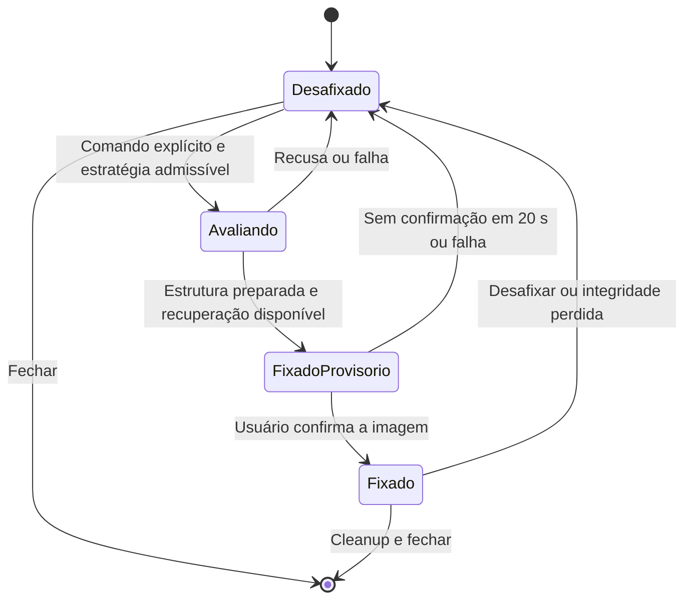

# Alternativas de fixação do Mural Institucional

Análise em 13/10/2026 — projeto WPF existente, .NET 10, Windows 11 Enterprise build 26100.

## 1. Recomendação e alcance

**Manter a janela convencional como modo operacional. Nenhuma alternativa interativa examinada oferece, com as evidências disponíveis, garantia simultânea de visibilidade após Win + D, posição atrás dos aplicativos, preservação dos ícones e independência da estrutura interna do Explorer.** Isso é a conclusão desta investigação, não uma prova de impossibilidade de qualquer implementação futura.

Se for aceitável exibir comunicados **sem interação direta**, a alternativa mais promissora é compor uma imagem de mural no papel de parede por uma API pública, mantendo a janela WPF para leitura completa e rolagem. Essa alternativa muda o fundo do usuário e exige aceitação específica e compatibilidade com a política corporativa. Não está autorizada nem implementada nesta etapa.

Se a interação permanente for indispensável, uma **AppBar lateral** merece avaliação separada, desde que o usuário aceite reservar área útil da tela. Ela altera a experiência originalmente pedida e não tem resistência a Win + D demonstrada nesta máquina sem Topmost. WorkerW deve continuar restrito a investigação experimental, com a recusa atual preservada.

Esta entrega contém apenas este documento. Foram lidos código, documentação local, logs existentes e referências públicas da Microsoft. Não houve execução do aplicativo, nova inspeção Win32 ao vivo, SetParent, alteração do papel de parede, registro de AppBar ou mudança do mecanismo de recuperação. Não foi executado build: não há mudança de código a compilar, e compilar não validaria as alternativas.

## 2. Evidências e inventário dos hosts

A base local é [DIAGNOSTICO_FIXACAO.md](DIAGNOSTICO_FIXACAO.md), confrontada com `desktop-integration.log`. Os handles abaixo pertencem ao diagnóstico anterior; não identificam permanentemente as janelas atuais.

```text
Desktop Win32 / sessão interativa
└── Progman 0x10132 — área do shell: 3840 × 1080
    ├── z=0: SHELLDLL_DefView 0x10136 — ícones, layered, alpha global 255
    └── z=1: WorkerW 0x7066A — visível, WS_DISABLED, atrás de DefView

Também foram enumerados WorkerWs top-level invisíveis.
```

O mural convencional tinha retângulo `(768,0)–(1920,1032)`, correspondendo a 60% da área útil de um monitor. O WorkerW abrangia a área de dois monitores, estava desabilitado e respondia à consulta WM_NULL. Não há evidência de travamento do host naquele instante. O processo do mural continuar ativo, conforme relato do usuário, não demonstra que sua imagem esteja sendo apresentada.

DefView cobre integralmente a região do mural e informa alpha global 255 sem color key. É evidência suficiente para a **recusa conservadora existente**, mas não uma inspeção dos pixels nem a prova isolada de toda a cadeia de composição. Não se deve confundir essa hipótese fundamentada com um diagnóstico visual definitivo. [GetLayeredWindowAttributes](https://learn.microsoft.com/en-us/windows/win32/api/winuser/nf-winuser-getlayeredwindowattributes) documenta os atributos consultados; [IsWindowVisible](https://learn.microsoft.com/en-us/windows/win32/api/winuser/nf-winuser-iswindowvisible) pode retornar verdadeiro para uma janela completamente coberta.

| Host ou localização | Evidência disponível | Viabilidade nesta máquina |
| --- | --- | --- |
| WorkerW filho de Progman | Único candidato visível descrito em detalhe; atrás de DefView e desabilitado. | Recusado. Não há justificativa para repetir o mesmo teste. |
| WorkerW top-level atrás do host dos ícones | A seleção atual contempla essa topologia clássica. Nos logs, os WorkerWs top-level enumerados estavam invisíveis; seus papéis não foram todos caracterizados. | Possibilidade em outra topologia, sem candidato compatível demonstrado aqui. Não exibir ou habilitar janelas do Explorer para fabricá-lo. |
| Outro WorkerW filho | O snapshot de filhos imediatos de Progman registra DefView e um WorkerW. | Nenhum segundo candidato documentado. O código examina o primeiro WorkerW filho; isso não equivale a um inventário recursivo de todo o Explorer. |
| Progman diretamente | Está acima do WorkerW na hierarquia, mas contém as mesmas camadas. | Ser seu filho não resolve a ordem relativa a DefView. Abaixo dos ícones pode continuar coberto; acima pode obstruir ícones à direita. Sem teste autorizado. |
| SHELLDLL_DefView ou sua lista de ícones | Superfície pertencente ao Explorer. | Não é um host público para controles de terceiros. Inserir conteúdo interfere com disposição, entrada e pintura dos ícones. Não recomendado. |
| HWND do desktop Win32 | Raiz do gerenciador de janelas, diferente da superfície de conteúdo do Explorer. | Não dá, por si só, acesso à camada correta do papel de parede nem garantia após Win + D. |
| Barra de tarefas ou outras janelas internas do shell | Fora da região de conteúdo desejada; sem evidência local de host apropriado. | Não aproveitar seus filhos como superfície de mural. AppBar pública é uma alternativa distinta. |

**Resultado do inventário:** não foi identificado outro host compatível nas evidências existentes. A classe WorkerW, por si só, não informa finalidade, estabilidade, transparência ou aptidão para receber um WPF interativo.

Uma investigação futura poderia completar o inventário somente leitura: PID do shell, hierarquia completa, ordem Z, visibilidade, enabled, cloaked, DPI, região cliente, interseção com o mural e destinatários de hit test. Isso precisaria mostrar uma diferença técnica real em relação ao host recusado. Nenhuma nova coleta foi executada aqui, e qualquer teste posterior de SetParent exigirá **justificativa específica e autorização explícita do usuário**.

## 3. Alternativas analisadas

### A. Janela WPF convencional na região direita

Usa os recursos já implementados: posicionamento na área útil, cartões, rolagem, moldura e controles nativos. É a opção de menor dependência do shell e mantém a interatividade. Não reserva espaço nem reorganiza os ícones.

Uma janela convencional pode cobrir ícones que estejam sob seu retângulo enquanto aberta. Liberar 40% à esquerda não comprova que os ícones existentes estejam todos ali. Após Win + D, ela participa do comportamento normal das janelas; **não cumpre a persistência visual pedida**. Essa limitação deve ser explícita, com recuperação pela barra de tarefas, sem prometer fixação.

### B. Janela independente com aparência de desktop

É possível estudar uma janela sem moldura, sem ativação automática e com posição baixa na ordem Z. A aparência pode se aproximar de um painel, mas a relação com o desktop permanece a de uma janela independente.

`WS_EX_TOOLWINDOW` altera principalmente a apresentação na barra de tarefas/Alt+Tab. `WS_EX_NOACTIVATE` evita ativação por clique e traz limitações para navegação e acessibilidade. Nenhum desses estilos documenta imunidade a Mostrar área de trabalho. [Extended Window Styles](https://learn.microsoft.com/en-us/windows/win32/winmsg/extended-window-styles).

Colocar o HWND em `HWND_BOTTOM` pode deixá-lo atrás do próprio Explorer; posicioná-lo acima do desktop e abaixo de aplicativos depende de uma ordem que muda. Um clique/ativação também pode alterar a ordem. **Inferência de projeto:** manter essa posição por ajustes contínuos cria competição com o shell e risco de piscar, cobrir aplicativos ou reaparecer quando o usuário queria ocultá-lo. [SetWindowPos](https://learn.microsoft.com/en-us/windows/win32/api/winuser/nf-winuser-setwindowpos) oferece controle de ordem Z, não um contrato de janela pertencente ao fundo do Explorer.

Viável como apresentação alternativa convencional, sem garantia de Win + D. Não recomendado como solução de fixação.

### C. Hospedagem em outro WorkerW ou em Progman

`SetParent` é uma API pública, mas a escolha de WorkerW/Progman/DefView como pontos de extensão depende da organização interna do Explorer. A mensagem `0x052C`, removida do projeto, também não constitui contrato público de hospedagem. Essa combinação continua **não documentada como integração de um mural ao desktop**, mesmo quando as funções P/Invoke individuais são documentadas.

Há riscos de cobertura, interceptação de entrada, recorte, mudança de hierarquia, perda de HWND e incompatibilidade DPI entre processos. A [documentação de SetParent](https://learn.microsoft.com/en-us/windows/win32/api/winuser/nf-winuser-setparent) exige gestão de estilos e descreve comportamento problemático com contextos DPI distintos.

Outro host só seria uma hipótese razoável se existisse naturalmente, tivesse geometria adequada e apresentasse evidência diferente do host recusado. Não alterar enabled, transparência, estilos ou ordem de janelas do Explorer; não reintroduzir mensagens de criação. Não realizar tentativas em sequência para encontrar uma combinação que pareça funcionar.

**Viabilidade atual:** nenhuma demonstrada no host observado. Interatividade e visibilidade após Win + D exigiriam testes próprios, além da confirmação inicial da imagem. O caminho existente deve continuar recusando essa máquina.

### D. Mural como imagem no papel de parede

Renderizar uma imagem com comunicados na região direita e aplicá-la ao monitor escolhido por `IDesktopWallpaper::SetWallpaper`. A interface pública permite consultar monitores e papel de parede; o método recebe o caminho de uma imagem e retorna HRESULT. [IDesktopWallpaper](https://learn.microsoft.com/en-us/windows/win32/api/shobjidl_core/nn-shobjidl_core-idesktopwallpaper), [SetWallpaper](https://learn.microsoft.com/en-us/windows/win32/api/shobjidl_core/nf-shobjidl_core-idesktopwallpaper-setwallpaper).

**Inferência técnica:** o conteúdo passa a fazer parte do fundo que Mostrar área de trabalho exibe. Isso evita hospedar um HWND WPF em um WorkerW e não requer interceptar Win + D. Os ícones continuam controlados pelo Explorer; imagens não capturam cliques. A região esquerda pode manter a imagem original, mas não é possível acrescentar uma superfície interativa apenas à direita por essa API.

Limitações: sem rolagem, botões, seleção ou interação no mural da imagem. Usar resumo dos cartões; leitura completa permanece na janela WPF. DPI, posição da barra de tarefas e modos de escala do fundo exigem composição por monitor; simplesmente esticar uma captura pode tornar textos ilegíveis.

Riscos: substituir preferência do usuário, conflito com apresentação de slides/Spotlight, política que fixa o fundo, texto sensível persistindo após fechar o app e restauração que sobrescreva uma mudança legítima feita pelo usuário. A imagem deve ser gravada somente em pasta do usuário; preservar configuração anterior e restaurar apenas o que a aplicação ainda controla.

Não depende de API privada nem de elevação solicitada pelo aplicativo. Política impeditiva ou erro de acesso deve levar à desistência, nunca à alteração da política. Usar a API pública de personalização altera o fundo, mas não modifica código/estrutura interna do Explorer. Se a restrição excluir também mudanças de personalização, esta alternativa fica fora do escopo. Nada disso foi aplicado nesta etapa.

### E. AppBar lateral registrada pela API pública

Uma AppBar é um HWND próprio ancorado em uma borda, com uma área negociada com o shell. Em princípio pode hospedar controles WPF interativos sem SetParent no Explorer. `SHAppBarMessage` oferece registro, negociação e remoção por `ABM_NEW`, `ABM_QUERYPOS`, `ABM_SETPOS` e `ABM_REMOVE`. [SHAppBarMessage](https://learn.microsoft.com/en-us/windows/win32/api/shellapi/nf-shellapi-shappbarmessage).

A documentação descreve reserva de área útil e notificações de posição/tela cheia. Não fornece, no material consultado, garantia específica de permanência com Win + D no build 26100 **sem Topmost**. O exemplo oficial contém ajustes com HWND_TOPMOST: não podem ser copiados nesta prova. [Using Application Desktop Toolbars](https://learn.microsoft.com/en-us/windows/win32/shell/application-desktop-toolbars).

**Inferência para este produto:** reservar 60% da largura prejudicaria o espaço para aplicativos e poderia alterar disposição de ícones/janelas. Uma faixa menor seria mais apropriada, mas muda o requisito. Também muda a ideia de outros aplicativos cobrirem normalmente o mural: há uma região reservada, não somente conteúdo de fundo.

Compatibilidade potencialmente melhor que WorkerW por usar um protocolo público, mas ainda não testada. Reservar espaço não é modificar internamente o Explorer, porém altera a área útil e exige aceitação do usuário. Desafixar/fechar teria de remover o registro e devolver o espaço antes de destruir o HWND. [ABM_REMOVE](https://learn.microsoft.com/en-us/windows/win32/shell/abm-remove).

### F. Reexibir uma janela após detectar Mostrar área de trabalho

Observar eventos e tentar mostrar a janela própria novamente, sem interceptar teclas, é diferente de integrar ao desktop. Pode introduzir atraso, oscilação de ordem Z e comportamento contrário à intenção do usuário. Não garante que outros aplicativos cubram o mural nem que o segundo Win + D mantenha a semântica normal.

Viabilidade: heurística experimental, não substituto confiável para fixação. Não recomendada como comportamento automático. A análise de eventos pode ser útil apenas para diagnóstico e recuperação, como descrito na seção seguinte.

### G. Trocar WPF por outra tecnologia de renderização

WinUI, renderização nativa, Direct2D ou DirectComposition poderiam ajudar a investigar um defeito de renderização específico. **Não eliminam, por si, uma camada opaca acima do HWND nem transformam uma janela independente em conteúdo de desktop.**

DirectComposition exige que o HWND alvo pertença ao processo chamador; não permite associar diretamente uma árvore visual às janelas do Explorer por essa API. Seu parâmetro `topmost` ordena conteúdo dentro do alvo, não é uma autorização para exibir uma janela sobre todo o sistema. [CreateTargetForHwnd](https://learn.microsoft.com/en-us/windows/win32/api/dcomp/nf-dcomp-idcompositiondevice-createtargetforhwnd).

Não recomendado reescrever a interface antes de existir uma estratégia de hospedagem justificável. Injeção no Explorer, hooks dentro de seu processo e extensões internas não são alternativas admissíveis às restrições.

## 4. Win + D sem interceptação

Mostrar área de trabalho não é apenas minimizar todas as janelas. Uma explicação técnica da Microsoft distingue Win + M de Win + D e descreve o desktop sendo colocado à frente das janelas restantes. É uma referência histórica do comportamento, não uma especificação da composição interna do Windows 11. **Consequência para a análise:** remover o comando de minimizar não garante sobrevivência a Win + D. [The Old New Thing: Minimize All and Show Desktop](https://devblogs.microsoft.com/oldnewthing/20040527-00/?p=39153/).

Uma observação futura poderia usar `SetWinEventHook` com `WINEVENT_OUTOFCONTEXT`, filtrando eventos relevantes e sem injetar DLL no Explorer. O callback recebe notificações assíncronas; precisa de loop de mensagens, controle de reentrância e liberação com UnhookWinEvent. Isso não é um hook de teclado que bloqueia atalhos. [SetWinEventHook](https://learn.microsoft.com/en-us/windows/win32/api/winuser/nf-winuser-setwineventhook).

Eventos de foreground, minimizar/restaurar, mostrar/ocultar ou cloaked não identificam univocamente Win + D. Minimização manual, Alt+Tab e outras transições podem produzir sinais semelhantes. `EVENT_SYSTEM_DESKTOPSWITCH` informa troca do desktop ativo; não deve ser tratado como evento de Win + D nem confundido automaticamente com desktops virtuais. [Event Constants](https://learn.microsoft.com/en-us/windows/win32/winauto/event-constants).

Nas APIs consultadas, **não foi identificado um contrato público que avise de forma exclusiva “Win + D acionado” e autorize uma janela comum a permanecer no fundo visível**. Consultar foreground/visibilidade por polling também produz uma hipótese, não esse contrato.

Proposta: deixar o Windows executar o atalho normalmente; observar apenas para registrar mudanças ou restaurar com comando explícito do usuário. Não registrar Win + D, instalar hook de teclado, cancelar minimização ou usar laço de ShowWindow/SetWindowPos para desfazer repetidamente o comando.

Desktops virtuais são outro problema: a interface pública `IVirtualDesktopManager` consulta associação e permite mover janelas entre espaços; não oferece hospedagem na camada de wallpaper ou imunidade a Mostrar área de trabalho. Não adotar interfaces privadas para “fixar em todos os desktops”. [IVirtualDesktopManager](https://learn.microsoft.com/en-us/windows/win32/api/shobjidl_core/nn-shobjidl_core-ivirtualdesktopmanager).

## 5. Comparativo

Avaliações abaixo são conclusões de engenharia desta análise, não resultados de testes novos. “Documentada” qualifica a API utilizada, não certifica o objetivo completo.

| Alternativa | Estabilidade/compatibilidade esperadas | Interatividade | Win + D | Dependência privada e riscos principais |
| --- | --- | --- | --- | --- |
| WPF convencional | Melhor base operacional; sem acoplamento à hierarquia do shell. | Completa. | Sem persistência garantida; aceita o comportamento normal. | Nenhuma necessária; pode cobrir ícones sob sua região. |
| WPF independente com estilos/ordem Z | APIs públicas, mas comportamento de “desktop” frágil. | Possível; NoActivate limita foco/acessibilidade. | Sem garantia. | Heurística de ordem Z; cobertura indevida e janela inacessível. |
| WorkerW/Progman | Baixa confiança entre builds/sessões; rejeitado na topologia observada. | Incerta. | Incerto, exige confirmação visual específica. | Hospedagem interna não documentada; DPI, cobertura, entrada, HWND destruído. |
| Imagem via IDesktopWallpaper | Melhor candidato para conteúdo passivo, condicionado ao fundo permitido. | Nenhuma na imagem; WPF separado para interação. | Esperado como parte do wallpaper, ainda sem teste local. | API pública; substituição do fundo, persistência e políticas. |
| AppBar sem Topmost | Protocolo público, compatibilidade a testar na máquina-alvo. | Completa no painel próprio. | Não demonstrado no build 26100. | Reserva de espaço, ícones/janelas reorganizados, cleanup obrigatório. |
| Reexibição orientada por eventos | Frágil por sinais ambíguos e corridas com o shell. | Completa quando visível. | Pode reaparecer; não é garantia nem fixação real. | APIs públicas, inferência privada do comportamento; oscilação e desrespeito ao comando. |
| Outra tecnologia gráfica | Não corrige a estratégia de hospedagem. | Depende do host. | Sem benefício demonstrado. | Custo de reescrita; eventual acoplamento continua. |

## 6. Arquitetura proposta: Fixado e Desafixado

**Proposta conceitual para uma etapa futura; nenhum componente abaixo foi criado ou substituído.** Os modos não devem mascarar diferenças entre painel interativo, imagem passiva e tentativa de hospedagem.

| Componente proposto | Responsabilidade |
| --- | --- |
| Conteúdo/apresentação compartilhados | Fonte única de cartões; visual WPF e, opcionalmente, resumo renderizado em imagem. |
| Coordenador de apresentação | Controlar Desafixado, transição provisória, Fixado com capacidade declarada e recuperação. Não conceder aprovação de Win + D automaticamente. |
| Estratégia convencional | Janela própria posicionada à direita, com controles nativos. Base operacional e destino obrigatório da recuperação. |
| Estratégia experimental WorkerW | Usar o DesktopIntegrationService existente com as proteções intactas; inativa para novos testes sem justificativa e autorização. |
| Estratégia opcional de imagem | Personalização pública, condicionada ao aceite de conteúdo passivo e mudança do fundo; restauração adicional do wallpaper. |
| Estratégia opcional AppBar | Painel lateral com reserva explicitamente aceita; nunca usar Topmost como fallback. |
| Recuperação e diagnóstico | Reutilizar integralmente controle separado, prazo, atalhos, Unpin, snapshot, logs e janela substituta. Estratégias novas precisam de cleanup próprio adicional. |



“Fixado” no diagrama significa apresentação confirmada naquele instante. Deve indicar a estratégia e as capacidades: “imagem sem interação”, “painel lateral” ou “hospedagem experimental”. Confirmar cartões não equivale a aprovar Win + D, ícones e todas as builds. Se não houver estratégia autorizada e admissível, o aplicativo permanece Desafixado; não simula sucesso com uma janela convencional.

### Recuperação a preservar integralmente

O código atual já contém: controle independente criado antes da tentativa, Ctrl+Alt+Shift+F12 para restaurar e Ctrl+Alt+Shift+F11 para fechar, rejeição se os registros falharem, prazo monotônico de 20 segundos sem confirmação, monitor de integridade, snapshot de estilos/geometria, restauração verificada e janela convencional substituta quando necessário. Fechar o controle cancela a fixação. Mantém-se uma tentativa por execução e o bloqueio na janela substituta.

Nada disso foi alterado. Há uma ressalva documentada pertinente à compatibilidade: **F12 é reservado ao depurador** na documentação de RegisterHotKey. O registro ter sido aceito no teste anterior não comprova disponibilidade universal ou disparo do atalho. Registra-se o risco sem mudar as combinações nesta entrega; uma revisão futura precisaria conservar caminhos independentes de saída e discutir um atalho alternativo apropriado. [RegisterHotKey](https://learn.microsoft.com/en-us/windows/win32/api/winuser/nf-winuser-registerhotkey).

Em uma estratégia de imagem, Desafixar deve restaurar o fundo controlado pelo aplicativo, além de manter a janela convencional. Para AppBar, remover a reserva por ABM_REMOVE. Tais cleanups são requisitos futuros, não substitutos do mecanismo atual. Falha, política impeditiva ou ausência de confirmação deve encerrar a transição, nunca disparar troca automática entre estratégias.

A recuperação atual depende da thread WPF responsiva e da sobrevivência do processo. Não há garantia de timer/atalho quando uma API nativa bloqueia essa thread, nem quando o Explorer destrói o filho. Este limite deve permanecer documentado.

## 7. Critérios para uma etapa futura

Antes de qualquer implementação, decidir qual compromisso é aceitável: mural interativo apenas em janela convencional, leitura passiva no wallpaper ou painel com reserva de área útil. A autorização desta análise não autoriza aplicação de fundo, AppBar ou SetParent.

Para um teste de SetParent, documentar previamente o novo candidato, sua diferença técnica em relação ao host recusado, hipótese de renderização/entrada, limites do teste e recuperação. Somente executar depois da autorização explícita; sem sequência de hosts ou repetição automática. A descoberta de um HWND com classe conhecida não basta.

| Critério de aceitação visual | Verificação necessária |
| --- | --- |
| Apresentação | Usuário vê os cartões à direita, sem tela preta, clipping ou recobrimento inesperado. |
| Win + D | Abrir outro aplicativo; pressionar Win + D e novamente para voltar. Confirmar visibilidade e semântica normal nos dois sentidos. |
| Aplicativos | Janelas comuns cobrem o mural quando aplicável e ele reaparece ao fechá-las; telas cheias não são obstruídas. Registrar a diferença de uma AppBar reservada. |
| Ícones | Acesso e posição preservados à esquerda e à direita; não depender de mover ícones para passar. |
| Entrada | Rolagem/cliques/foco/acessibilidade no modo interativo. Para wallpaper, declarar esses recursos indisponíveis. |
| Recuperação | Não confirmar e esperar o prazo; usar controle separado e ambos os atalhos; desafixar e fechar; verificar cleanup e ausência de processo remanescente. |
| Compatibilidade | Monitores/DPI diferentes, barra de tarefas, desktops virtuais e sessão remota quando usados pela instituição. |
| Política e restauração | Não alterar políticas; em wallpaper, conferir fundo anterior e mudanças legítimas do usuário; em AppBar, conferir devolução da área útil. |

Uma compilação bem-sucedida só verifica parte da consistência do código. Registro de AppBar, retorno S_OK de SetWallpaper, GetParent correto ou WS_VISIBLE também não aprovam os cenários acima. Nenhuma dessas alternativas foi validada nesta etapa.

## 8. Decisão recomendada

Para o projeto atual, manter **Desafixado operacional e Fixado recusado no host diagnosticado**, com todas as proteções existentes. Não retestar o WorkerW sem nova evidência e autorização.

Para evolução, priorizar estudo de **imagem no wallpaper + janela WPF convencional** se a instituição aceitar conteúdo passivo e personalização do fundo. É o caminho mais direto para leitura no desktop sem depender de hosts internos ou reagir ao atalho. Se for exigida interação contínua, avaliar AppBar como um produto diferente, com espaço reservado e Win + D ainda a testar.

Se forem simultaneamente obrigatórios interação WPF, 60% de largura, nenhuma reserva, ícones intactos, ausência de Topmost e permanência garantida após Win + D, **o conjunto completo permanece sem solução confiável demonstrada para este ambiente**. Comunicar essa limitação e preservar o funcionamento convencional é a recomendação fundamentada.
